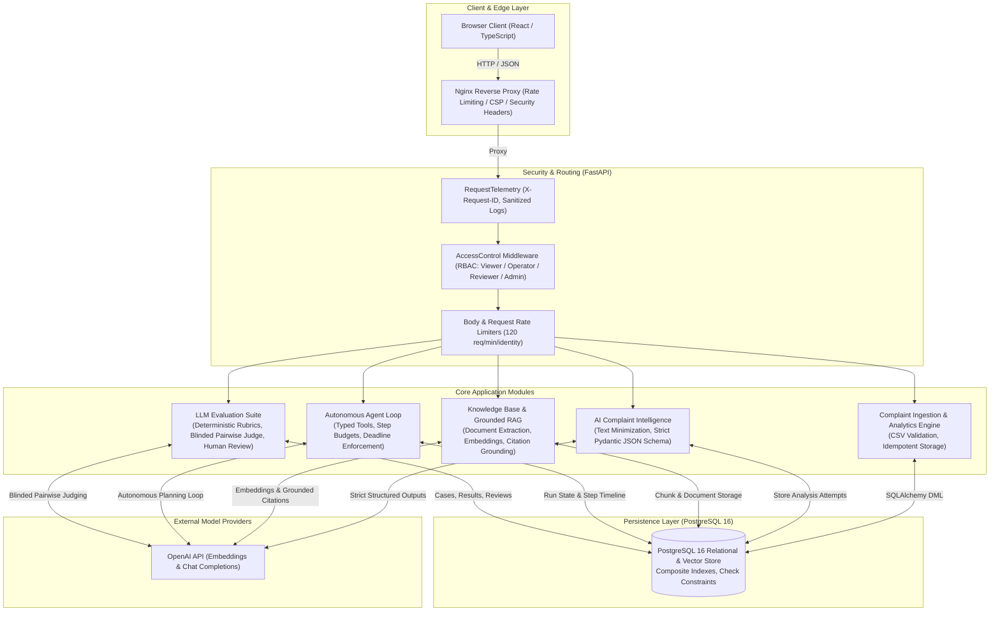

# NeuroOps AI — AI Engineer Portfolio Guide & System Architecture

This guide presents the architecture, engineering decisions, demonstration workflow, and technical interview defense for **NeuroOps AI**, an enterprise-grade AI Operations & Complaint Intelligence platform.

---

## 1. Resume Project Summary

**NeuroOps AI — Enterprise AI Operations & Grounded Complaint Intelligence Platform**  
*Technologies:* Python 3.13, FastAPI, React 18, TypeScript, PostgreSQL 16, SQLAlchemy, Alembic, OpenAI Structured Outputs, Vector Embeddings (RAG), Nginx, Docker.

- **Engineered an enterprise customer intelligence platform** processing complaint data pipelines with idempotent ingestion, automated triage, and real-time operational analytics.
- **Implemented a privacy-first LLM triage pipeline** utilizing deterministic text minimization to strip PII and enforce strict OpenAI JSON Schema validation (`temperature=0`), achieving structured classification and sentiment analysis.
- **Architected a production RAG knowledge system** featuring chunking with overlap, vector similarity search, and citation grounding that validates model claims against source passages.
- **Designed a bounded autonomous investigation agent** with typed tool execution (complaint inspection, document retrieval, synthesis), explicit step/timeout budgets, cooperative mid-run cancellation, and failure recovery.
- **Built an LLM Evaluation & Review suite** supporting deterministic rubrics (exact match, citation overlap), blinded pairwise LLM judging with order-swap debiasing, and an auditable human-in-the-loop review workflow.
- **Hardened full-stack security & telemetry** with multi-tenant workspace isolation, SHA-256 hashed Bearer token RBAC (viewer/operator/reviewer/admin), sanitized error responses, request telemetry correlation IDs, and non-root read-only container definitions.

---

## 2. System Architecture & Data Flow

---

## 3. Major Module Deep Dive

### 3.1. Complaint Ingestion & Analytics (`backend/app/ingestion.py`, `routes.py`)
- **Idempotency:** Utilizes PostgreSQL `ON CONFLICT DO NOTHING` on primary key `complaint_id`.
- **Validation Pipeline:** Pre-database in-memory UTF-8 decoding, strict column presence check, regex constraint enforcement, and row-level error reporting.
- **Safety:** Streams uploads directly in memory without disk persistence; hard limit of 2 MiB and 5,000 rows.

### 3.2. Data-Minimized AI Intelligence (`backend/app/intelligence.py`, `analysis_routes.py`)
- **Data Minimization:** `minimize_text()` filters raw complaint text against an allowed complaint vocabulary, stripping customer names, numbers, order codes, and email addresses.
- **Schema Enforcement:** Employs OpenAI Structured Outputs with `response_format={"type": "json_object"}` mapped to Pydantic models.
- **Triage Heuristic:** Deterministic priority assignment rules (Safety keywords $\rightarrow$ High; Negative sentiment $\rightarrow$ Medium; otherwise Low).

### 3.3. Knowledge Base & Grounded RAG (`backend/app/knowledge_*.py`)
- **Extraction Limits:** Bounded document parsing (5 MiB max, 20 pages max, 64,000 characters).
- **Workspace Isolation:** Every chunk and query is scoped by `workspace_id` derived from tenant keys.
- **Citation Grounding:** Requires the LLM to output exact text quotes from retrieved source passages. The backend verifies that the quote is a verbatim substring of the chunk before accepting the claim.

### 3.4. Bounded Autonomous Agent Workspace (`backend/app/agent_*.py`)
- **Architecture:** ReAct-style planning loop with typed tools (`search_knowledge`, `get_complaint`, `summarize_findings`).
- **Safety Boundaries:** Hard cap on steps (`AGENT_MAX_STEPS = 6`), total execution deadline (`timeout = 60s`), and cooperative mid-run cancellation.
- **Resilience:** Background sweeper (`app/job_maintenance.py`) reaps orphaned or crashed runs every 15 seconds.

### 3.5. LLM Evaluation & Review Suite (`backend/app/evaluation_*.py`)
- **Deterministic Rubrics:** Versioned evaluation algorithms testing exact match, citation precision, and length constraints without consuming LLM tokens.
- **Blinded Pairwise Judging:** Pairs responses, shuffles positions (A/B vs B/A) to prevent position bias, and flags disagreements.
- **Human-in-the-Loop Review:** Dedicated reviewer API key and role with append-only feedback storage (`approve`, `reject`, `correct`).

### 3.6. Security, RBAC & Operations (`backend/app/security.py`, `operations.py`)
- **Authentication:** Per-user SHA-256 hashed Bearer tokens. Tokens are kept in browser memory and never stored in localStorage.
- **Role Hierarchy:** Discrete RBAC (`viewer`, `operator`, `reviewer`, `admin`).
- **Telemetry:** Middleware generates unique `X-Request-ID` headers, logs request latency and status, and sanitizes query parameters and credentials.

---

## 4. Key Engineering Decisions & Trade-Offs

| Decision | Chosen Approach | Alternative Considered | Trade-Off & Justification |
| :--- | :--- | :--- | :--- |
| **LLM Output Formatting** | Strict Pydantic JSON Schema | Free-form text prompts with regex parsing | Eliminates parsing errors and hallucinated keys, at the cost of requiring models supporting JSON Schema mode. |
| **Data Privacy** | In-flight vocabulary minimization | Sending raw complaint text with PII | Prevents customer PII leakage to external LLMs; sacrifices subtle linguistic nuance and non-English context. |
| **Citation Verification** | Verbatim substring check against source chunk | Relying on model-generated citations | Model-generated citations often fabricate quotes; verbatim checks guarantee grounding but reject slight paraphrasing. |
| **Agent Execution** | Synchronous bounded step loop with cooperative deadlines | Unbounded Celery background task graph | Drastically reduces operational complexity and cost risk while maintaining safety for customer service triage tasks. |
| **Evaluation Strategy** | Deterministic metrics first, blinded LLM judge second | 100% LLM-as-a-judge | Saves cost and provides reproducible baselines; LLM judge reserved for nuanced qualitative comparison. |
| **Storage Architecture** | PostgreSQL with composite indexes & constraints | NoSQL / Document Store (MongoDB) | Relational constraints prevent corrupted states; transactional migrations via Alembic guarantee reproducibility. |

---

## 5. Five-Minute Project Demonstration Script

### Minute 1: Overview & Secure Access (0:00 - 1:00)
- "NeuroOps AI is an enterprise customer complaint intelligence and knowledge management system designed for operational reliability and AI safety."
- Show the **AccessGate** login screen. Explain that authentication uses SHA-256 hashed Bearer tokens stored only in browser memory, with 4 RBAC roles (`viewer`, `operator`, `reviewer`, `admin`).
- Sign in as `operator_user` to demonstrate role privileges.

### Minute 2: Complaint Ingestion & Analytics (1:00 - 2:00)
- Navigate to the **Complaints Dashboard**.
- Highlight that charts and metrics reflect live database state (never hardcoded mock figures).
- Demonstrate the CSV Import API: show how the parser handles valid rows while skipping duplicates (`ON CONFLICT DO NOTHING`) and enforcing 2 MiB / 5,000-row bounds.

### Minute 3: AI Complaint Triage & Privacy Filtering (2:00 - 3:00)
- Select a complaint and trigger **AI Classification**.
- Explain the data minimization filter: show how customer names and phone numbers are stripped before the prompt reaches OpenAI.
- Show the returned classification: category, sentiment, suggested priority, and rules snapshot, clearly labeled **AI suggestion · Unverified**.

### Minute 4: Grounded Knowledge Base & Agent Investigation (3:00 - 4:00)
- Navigate to the **Knowledge Base**. Show workspace document indexing and grounded retrieval with verified source citations.
- Switch to the **Agent Workspace**. Launch an investigation task (e.g., *"Investigate refund eligibility for damaged delivery CMP-1"*).
- Watch the live timeline: the agent executes bounded tool calls (`get_complaint`, `search_knowledge`), enforces step limits, and synthesizes findings with exact document citations.

### Minute 5: Evaluation Suite & Production Telemetry (4:00 - 5:00)
- Open the **Evaluation Workspace**. Show synthetic test datasets, deterministic metric distributions, and blinded pairwise response comparisons.
- Demonstrate the **Human-in-the-Loop** review workflow: approve/reject with reviewer attribution.
- Conclude by highlighting production operations: health/readiness endpoints, structured logs with `X-Request-ID`, and sanitized error responses.

---

## 6. Technical Interview Questions & Answers (Code-Defended)

### Q1: How do you prevent hallucinated outputs from the LLM in your triage pipeline?
**Answer:** In [`backend/app/intelligence.py`](file:///C:/Users/mayank%20singh/Desktop/neuroops-ai/backend/app/intelligence.py), we enforce OpenAI Structured Outputs using Pydantic schemas. The API call specifies `response_format={"type": "json_object"}` with `temperature=0`. Any model output that deviates from the schema or introduces unapproved categories is rejected by Pydantic validation before reaching the database.

### Q2: What is your strategy for data privacy and PII protection when sending data to third-party LLMs?
**Answer:** In [`backend/app/intelligence.py`](file:///C:/Users/mayank%20singh/Desktop/neuroops-ai/backend/app/intelligence.py#L40-L70), the `minimize_text()` function filters input text against a domain-specific complaint vocabulary. Numbers, contact info, URL patterns, and arbitrary out-of-vocabulary tokens are stripped. Additionally, `store: false` is transmitted in provider headers.

### Q3: How do you verify that citations generated by your RAG pipeline are grounded and not fabricated?
**Answer:** In [`backend/app/knowledge_provider.py`](file:///C:/Users/mayank%20singh/Desktop/neuroops-ai/backend/app/knowledge_provider.py) and [`knowledge_service.py`](file:///C:/Users/mayank%20singh/Desktop/neuroops-ai/backend/app/knowledge_service.py), the model must return both a `source_id` (chunk UUID) and an exact verbatim `quote`. The service checks that `claim.quote in source.passage`. If the quote cannot be found verbatim in the retrieved chunk, the claim is rejected as ungrounded (`sufficient=False`).

### Q4: How do you prevent runaway execution in your autonomous AI agent?
**Answer:** In [`backend/app/agent_planner.py`](file:///C:/Users/mayank%20singh/Desktop/neuroops-ai/backend/app/agent_planner.py) and [`agent_service.py`](file:///C:/Users/mayank%20singh/Desktop/neuroops-ai/backend/app/agent_service.py), the execution loop enforces three hard boundaries:
1. `AGENT_MAX_STEPS` (default: 6 steps).
2. `AGENT_TIMEOUT_SECONDS` (default: 60s deadline).
3. Cooperative cancellation checks on every step: if the client requests cancellation or the deadline expires, the run finishes with status `cancelled` or `timed_out`.

### Q5: How do you handle zombie or orphaned agent tasks if the server restarts mid-run?
**Answer:** In [`backend/app/job_maintenance.py`](file:///C:/Users/mayank%20singh/Desktop/neuroops-ai/backend/app/job_maintenance.py), a dedicated maintenance thread runs `sweep()` every 15 seconds. It queries runs where `status IN ('queued', 'running') AND expires_at <= time.time()` using `with_for_update(skip_locked=True)` and marks them `timed_out`. Crucially, it does **not** automatically replay paid LLM calls to prevent unexpected charges.

### Q6: How does the evaluation system mitigate position bias in pairwise comparisons?
**Answer:** In [`backend/app/evaluation_service.py`](file:///C:/Users/mayank%20singh/Desktop/neuroops-ai/backend/app/evaluation_service.py), when running pairwise comparison between response A and response B, the system blinds the model names and runs two mirrored passes: `(A, B)` and `(B, A)`. If the judge selects the first position in both passes, a position bias disagreement is detected and recorded in `EvaluationComparison`.

### Q7: Why do you store access tokens as hashes instead of raw strings?
**Answer:** In [`backend/app/security.py`](file:///C:/Users/mayank%20singh/Desktop/neuroops-ai/backend/app/security.py), user tokens are configured in `AUTH_USERS_JSON` as SHA-256 digests (`token_sha256`). When a request arrives, the Bearer token is hashed and compared using `secrets.compare_digest()` to prevent timing attacks. Raw tokens are never stored on the server or logged.

### Q8: How do you isolate tenant data across multiple workspaces?
**Answer:** Every table (`knowledge_documents`, `knowledge_chunks`, `agent_runs`, `evaluation_cases`) includes a `workspace_id` column with a composite index `(workspace_id, created_at)`. All queries enforce `WHERE workspace_id = :workspace_id`. Workspace identity is bound to the verified Bearer token or capability key, preventing cross-tenant access.

### Q9: How do you prevent sensitive credentials from leaking in logs or error traces?
**Answer:** In [`backend/app/operations.py`](file:///C:/Users/mayank%20singh/Desktop/neuroops-ai/backend/app/operations.py) and [`main.py`](file:///C:/Users/mayank%20singh/Desktop/neuroops-ai/backend/app/main.py):
1. `RequestTelemetry` middleware logs only normalized routes, status, and duration—stripping query strings and Authorization headers.
2. A custom `RequestValidationError` handler strips the submitted user payload from 422 responses.
3. Database exceptions are caught and sanitized to generic 500/503 messages without leaking SQL syntax or connection strings.

### Q10: Why did you choose Alembic for database migrations over SQLAlchemy `create_all()`?
**Answer:** `create_all()` only creates tables if they do not exist; it cannot alter existing schemas, add indexes, or modify constraints. Alembic provides deterministic, version-controlled DDL migrations (from `0001_complaints` to `0006_operations`) that allow rolling upgrades and schema validation across staging and production without data loss.

### Q11: How do you prevent Denial of Service (DoS) attacks on file upload endpoints?
**Answer:** We enforce strict multi-layered limits:
- Nginx edge: `client_max_body_size 10m` and `limit_req 10r/s burst=40`.
- Application middleware: `KnowledgeQuestionLimit` and `EvaluationBodyLimit` reject requests exceeding size thresholds before full parsing.
- Streaming parsers: CSV uploads are limited to 2 MiB and 5,000 rows; PDF files are limited to 5 MiB and 20 pages max.

### Q12: How are database connection pools managed to prevent connection exhaustion?
**Answer:** In [`backend/app/database.py`](file:///C:/Users/mayank%20singh/Desktop/neuroops-ai/backend/app/database.py), the SQLAlchemy engine uses `pool_size=5`, `max_overflow=5`, `pool_timeout=5`, and `pool_pre_ping=True`. Furthermore, PostgreSQL connection arguments enforce `statement_timeout=15000` (15s), `lock_timeout=5000` (5s), and `idle_in_transaction_session_timeout=120000` (2m) to prevent runaway transactions.

### Q13: What happens if an external LLM provider experiences an outage or rate limit?
**Answer:** In [`backend/app/intelligence.py`](file:///C:/Users/mayank%20singh/Desktop/neuroops-ai/backend/app/intelligence.py), HTTP client errors are caught and translated into specific `IntelligenceError` codes: 429 becomes `rate_limited`, 504 becomes `timeout`, and 502 becomes `provider_unavailable`. An attempt record is still committed to the database with `status='failed'` and the error code, ensuring transparency without crashing the application.

### Q14: Why do you avoid automatic retries for failed LLM provider calls?
**Answer:** Automatic retries for generative AI models risk generating unexpected billing spikes and compounding upstream rate limits during provider incidents. Instead, we persist the failed attempt explicitly and allow operators or users to initiate an intentional retry from the UI.

### Q15: How is the frontend protected against cross-site scripting (XSS) and token theft?
**Answer:** 
1. Tokens are held exclusively in React component memory and never written to `localStorage` or `sessionStorage`.
2. Nginx applies a strict Content Security Policy (`default-src 'self'; script-src 'self'; object-src 'none'`).
3. React automatically escapes interpolated JSX variables.

---

## 7. Honest Limitations & Roadmap Improvements

1. **Database Role Provisioning:** The current Docker Compose environment utilizes the database owner account for both migrations and runtime queries. A production deployment requires separating DDL migration credentials from restricted DML runtime credentials.
2. **Distributed Rate Limiting:** Rate limiters currently operate in process memory. Multi-replica cluster deployments require a shared Redis backplane.
3. **PDF Sandboxing:** While PDF extraction is bounded in memory and page count, hostile PDF exploits require running extraction inside an isolated, sandboxed WebAssembly or containerized worker.
4. **Asynchronous Distributed Worker Queue:** Agent runs and pairwise evaluations are processed synchronously within API worker threads. Scaling to high enterprise concurrency warrants migrating agent execution to a durable distributed task queue (e.g., Celery or Temporal).
